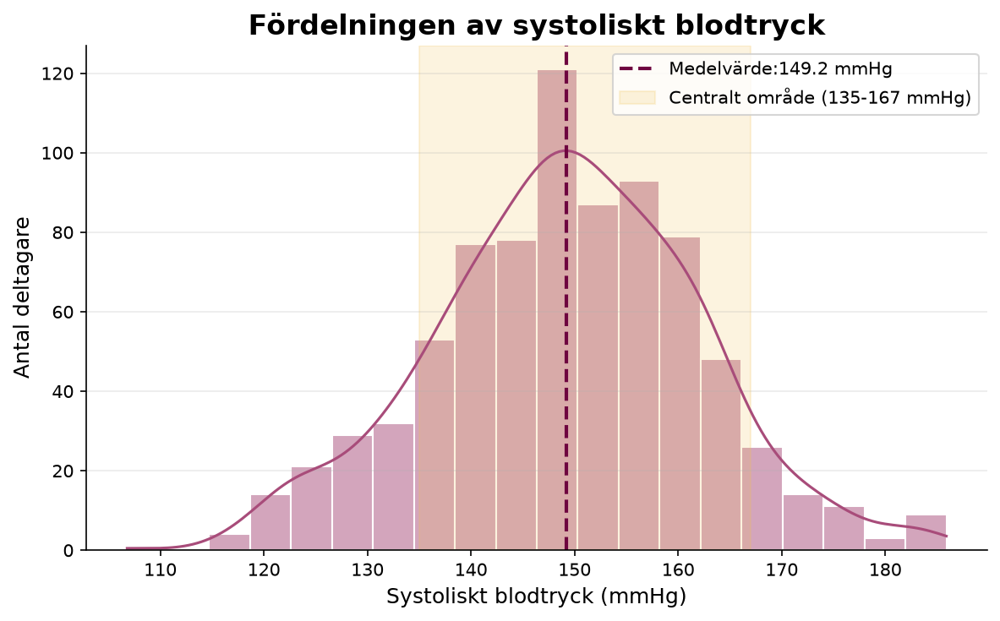
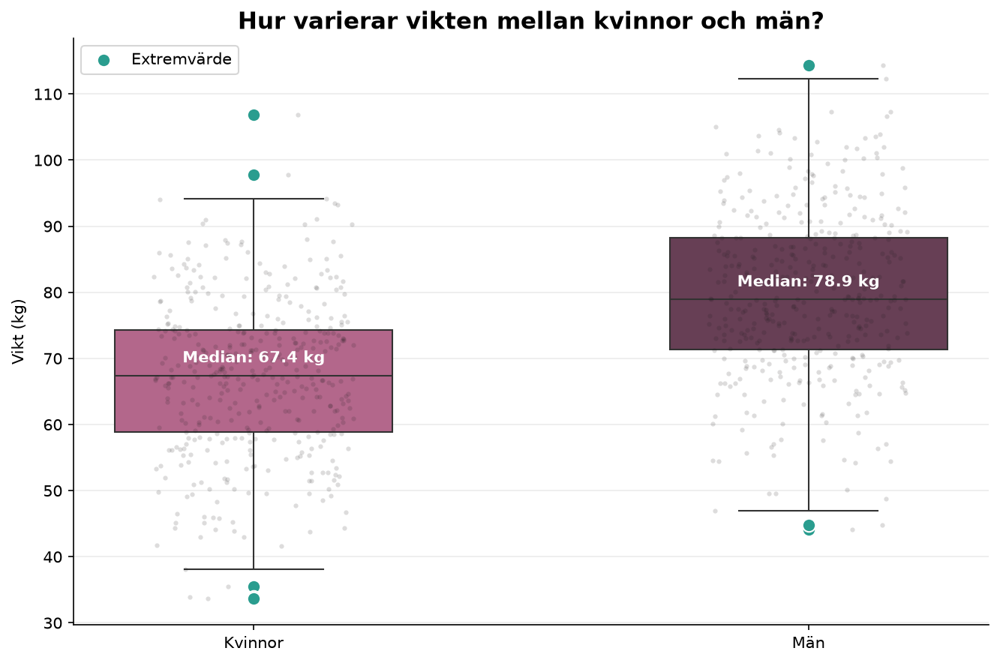
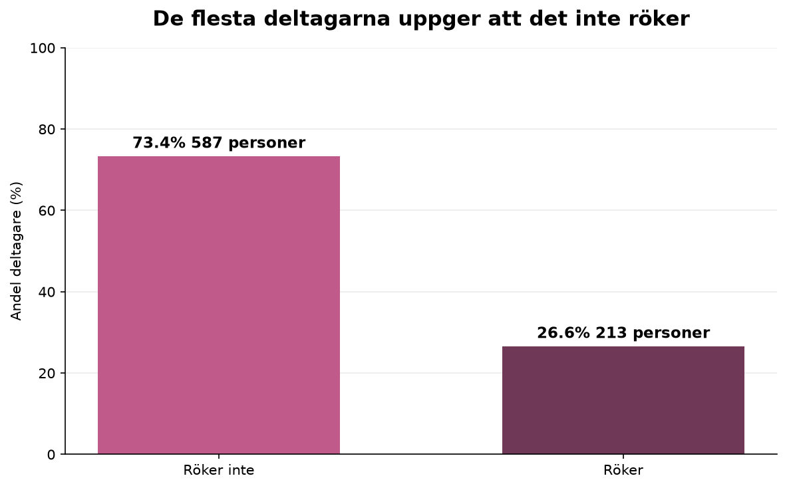
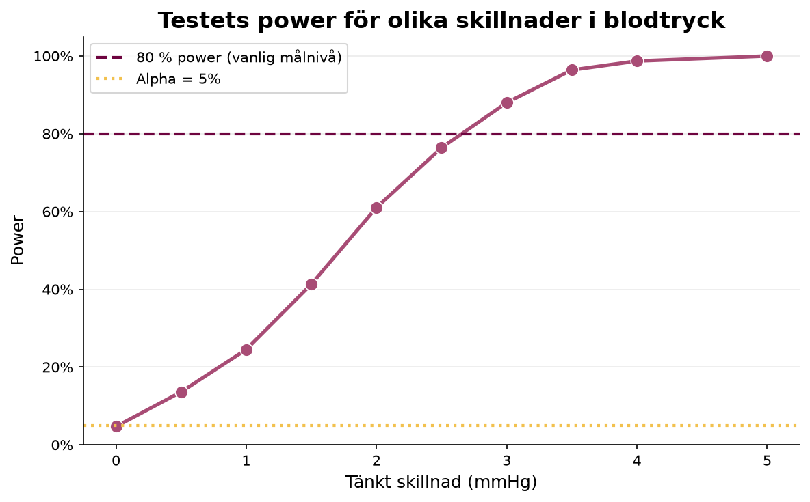

## Resultat 

### Fördelning av systoliskt blodtryck


Medelblodtrycket bland 800 deltagarna är 149,18 mmHg.

### Vikt per kön


Medianvikten är 78,9 kg bland män och 67,4 kg bland kvinnor. 

### Antalet rökare 


Diagrammet visar att 73,4 % röker inte och 26,6 röker. 

### Testets power


Testet når 80 % power först vid en skillnad på 3,0 mmHg.

## Miljö
Projektet använder Python 3.14.7.
Installera de paket som behövs från projektets huvudmapp med:

```bash
python -m pip install -r requirements.txt

